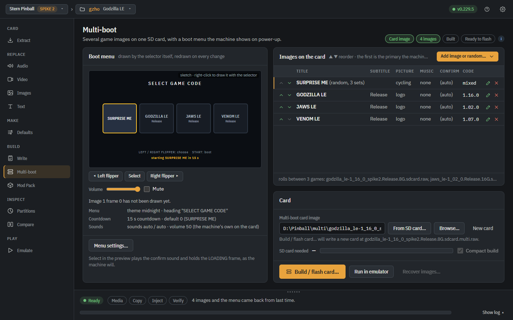

# Multi-boot cards

[← Back to the README](../../README.md)

The Multi-boot tab puts several complete games on one machine at once: the
stock code next to your own build, say. At power-up the machine shows a menu,
you pick a game with the flippers, and START boots it. You don't have to swap
cards.

## At a glance

| | Stern Spike 2 | Jersey Jack | Barrels of Fun |
|---|---|---|---|
| You build | an SD card | an install stick, or the game's SSD | one `.fun` update file |
| Games | up to 16 in the menu | 2, same game version | stock + up to 3 builds |
| Random cards | Yes | No | Yes |
| Compact build | Yes | No | No |
| Run in emulator | Yes | Yes | No |

**What you need:** Windows with WSL2, or Linux. A Mac works too, with
[Docker Desktop](#building-on-a-mac).

## Stern Spike 2: making a card

1. **Add your images.** Each one is a full Spike 2 card image: the stock
   code, a card you built with this app, or another build. The **first image
   is the primary**. The card boots from its files, and the machine falls
   back to it if the menu ever fails.
2. **Dress each one up (optional).** Click **✎** on a row to give it a title,
   a subtitle, a picture or video clip, music, and a confirm sound. The
   dialog draws the card next to the fields, the way the menu will.
3. **Set up the menu (optional).** **Menu settings…** holds everything that
   applies to the whole menu. See [Menu settings](#menu-settings).
4. **Check the size.** The strip under the list names the SD card size you
   need. See [Card size and Compact build](#card-size-and-compact-build).
5. **Build / flash card…** writes the card. It can also flash it onto an SD
   card in the same run. You pick the SD card in the next dialog, and nothing
   is written until you confirm.

The preview at the top of the tab draws the menu exactly as the machine will.
Use the flipper buttons under it (or the arrow keys) to move the highlight.
Tick **Sound** to hear the music and menu sounds.

**Run in emulator** opens the finished card on the Emulate tab, so you can
try the menu and each game on your PC first.

### On the machine

- The flippers move the highlight and START boots it.
- A countdown boots the last game you chose if nobody presses anything.
- From five games on, the menu scrolls three at a time and shows a counter
  under the cards.

### Random cards

**Add image or random…** adds one menu card that boots a different game
each time, whether you pick it or the countdown does. It can roll between
games already on the card, or between games of its own, such as forty song
sets of one title that all look like one stock card.

- **Truly random** can give you the same game twice. A tick can stop it
  repeating the last one.
- **Shuffle** plays every game once before any repeats, like a music player.
- The card can show the games' logos fanned out, a big **?**, a slot reel, a
  picture of your own, and more. It has its own music and confirm sound.

**Base card + edits folder:** a song set doesn't need a whole card. Give the
tab the stock card plus a folder holding only the files that set changes,
and everything else is read from the stock card. This turns on Compact
build.

### Menu settings

| Setting | What it does |
|---|---|
| **Heading** | The line across the top: SELECT GAME CODE unless you change it. Leave it empty for no heading. |
| **Count the cards under them** | The `< 3 / 7 >` line under the cards (five cards or more). Untick it for artwork cards. |
| **Countdown says** | The word in `starting The Beatles in 9 s`. Your word also replaces LOADING while the game starts. |
| **Same text size on every card** | Draws every title at one size, so a long name doesn't end up smaller than its neighbours. |
| **Move / confirm sounds** | *auto* takes a click and a stinger from the primary image, *synth* makes tones, or pick a WAV. |
| **Countdown** | Seconds before the countdown boots. 0 waits for START. |
| **End the menu with a SETTINGS card** | See [The SETTINGS card](#the-settings-card). |

Every sound box has a **▶ Play** button so you can hear it on the spot. Each
sound list also offers the WAVs the menu already uses, so putting one clip
on every game is a quick pick from the list.

An image's confirm sound plays when you press **START** on it. Scrolling
plays the menu's move click.

### The SETTINGS card

When a game on the card has an adjustable color profile, the menu ends with
a gear card (on by default). On the machine, **Settings > Color
correction** lets you adjust each game's colors without a computer:
brightness, contrast, saturation, shades, and color levels per channel. A
test card on the glass shows the changes live. Then **Save for this game**
or **Save for every game**.

The new values take effect the next time that game starts. The game's files
on the card are never changed, and if anything goes wrong the game runs as
built. A card built with v1.60.x or older has no SETTINGS card until you
rebuild it.

### Editions: one game, no menu

For **every Stern Spike 2 game at its latest version** (not James Bond 007
Premium/LE, James Bond 60th or Star Wars Premium/LE, whose game programs
cannot grow), a card can hold several
*editions* of one game, such as a Standard look and a 70th Anniversary look,
and skip the menu altogether. The operator picks the edition in the game's
own menu instead:

1. Make each edition as its own project from the same card. On each one's
   Write tab, **Name the editions...** gives them all the same names in the
   same order.
2. Add the images here with edition 1 first.
3. In Menu settings, tick **No menu: boot the edition the game's EDITION
   setting names**.

On the machine, set **EDITION** under *Adjustments > Machine Settings >
Attract Mode* (on a game whose Adjustments have *Standard Adjustments*: the
last row of that list). The chosen edition boots at the next power-up, and edition 1
boots if nothing has been set. All the editions share the game's settings
and high scores. The build refuses an image that is a different game or
version, or that has different edition names.

### Card size and Compact build

The strip under the list names the SD card size you need, and checks again
whenever the list changes. Click it to measure again. It also explains when
the card has to be bigger than the games: free space is kept so an image
can be updated in place later.

**Compact build** (off by default) stores files that the images share only
once. For example, three images of one title that needed a 32 GB card fit
on 16 GB. A song-set variant then costs only its changed songs.

### Changing a card later

- **A card you built:** point the path box at it and every field fills in.
  A changed title, picture or setting is written in seconds, and a changed
  image writes only its changed files, in about a minute. You don't need
  to rebuild.
- **The card in the reader:** **From SD card…** reads just the boot menu
  (and writes your changes back onto that card), or reads the whole card
  into a `.raw` file.
- **A card someone else built:** it loads and draws its menu, but its files
  point at their PC. **Recover images…** writes each game back out as a
  normal card image, copies the pictures and sounds out beside them, and
  from then on the card works like one you built.

> **Never update a multi-boot card with a Stern USB update.** Rebuild or
> update it here instead. This matters most for a compact card, where an
> update would write through the shared files into every game at once.

Every game on the card boots with its game-validation check switched off,
so a GAME VALIDATION ERROR from one game can't carry over to the next.

## Jersey Jack

The tab takes **two JJP install ISOs of the same game version** (for
example, the stock code and a retheme you built here). **Build / make
stick…** turns them into one multi-boot install stick.

- Install it the way you install any JJP stick, with the purple security
  key in. Like every JJP install, it wipes settings and scores.
- Use a USB port on the computer in the backbox. The cabinet's front slot
  can be thirty times slower.
- At power-up the flippers choose and START (or **Action**) boots. The
  volume buttons set the menu's volume. A maintenance reboot boots the same
  game again without the menu.
- The **Onto:** row can install straight onto the game's SSD in a dock on
  this PC, with no stick. On an SSD that already has the install, **Write:**
  can replace only the boot menu or only one game, and keeps the settings
  and scores.

Both games must be the same game version because they share one settings
partition. The tab refuses a mismatch and tells you why.

## Barrels of Fun (Labyrinth)

The tab takes the stock `.fun` plus up to three more builds of the same game
(a mod such as the Sarah code, say). **Build update…** writes one `.fun`
under the game's own name (`lab.fun` for Labyrinth).

- Copy it onto a FAT32 USB stick and install it like any Barrels of Fun
  update. The menu appears from the next power-up.
- The flippers choose, START or LAUNCH boots, and the countdown boots the
  last build you chose.
- Each card can have a picture or video clip, music and a confirm sound, and
  **Add random over the images above…** adds a random card. *auto* uses each
  build's own title video and music.
- Every build after the first is stored as its difference from the first, so
  the file stays under FAT32's 4 GB limit. The stock and Sarah code together
  come to about 3.2 GB. The size strip tells you if it won't fit.
- All the builds share one set of settings and scores.
- Installing any normal update afterwards removes the menu.

| Game | Supported |
|---|---|
| Labyrinth | Yes |
| Dune, Winchester | Not yet (they update differently) |
| Bon Jovi | No (its updates are signed) |

## Building on a Mac

The tab's tools are Linux tools, so on a Mac the app runs them in a Linux
container. **Docker Desktop** must be installed and running. If it isn't,
the tab tells you which of the two is wrong and writes nothing.

- The first card you write builds the container. After that it is reused.
  On Apple silicon it runs emulated, so the first time takes a few minutes.
- No password is asked for.
- The preview, the size strip and reading a card all work without Docker.
