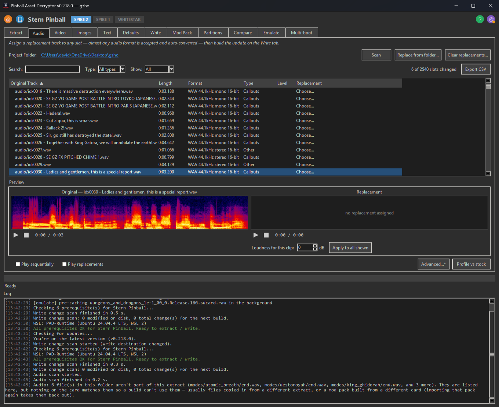
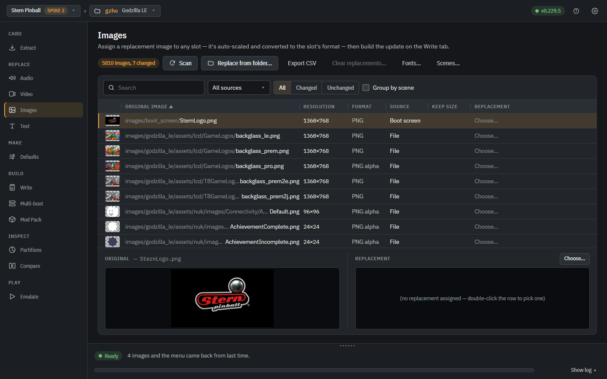
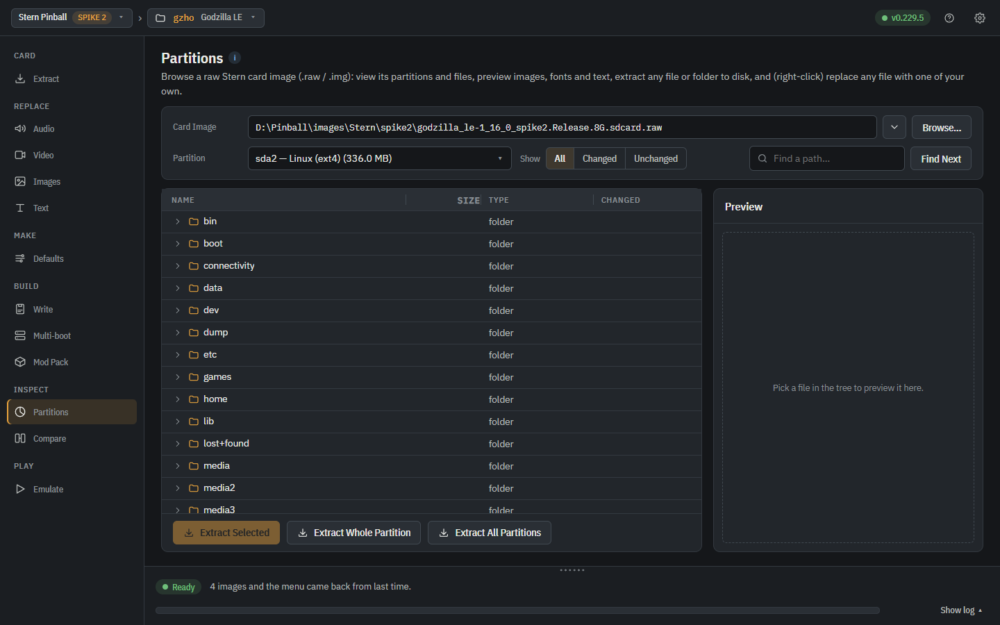

# Using the app

[← Back to the README](../../README.md)

A walk through the app from launch to a finished card. Emulating a game
and multi-boot cards have pages of their own: [Emulate](emulate.md) and
[Multi-boot cards](multi-boot.md). New to the app? [Getting started: your
first mod](getting-started.md) is a shorter walk through one song swap, and
[Common problems](common-problems.md) lists what new users run into.

**A mod is four steps, one tab each:**

1. **Select card**: pick the card image.
2. **Extract**: copy its files into a project folder.
3. **Replace**: swap the sounds, videos, pictures and text you want.
4. **Write**: build a new card image, then flash it.

Every tab has a **?** button in the top bar with tips for that tab.

## Getting started

- **The Getting started page** opens the first time the app starts: a short
  video and a few steps for each common job (extract a card, swap a song,
  build and flash, write an image to an SD card, a multi-boot card, trying
  it in the emulator, moving mods to a new game version). The **Getting
  started** button in the top bar brings it back, and a tick on the page
  opens it at every start.
- **The picker** shows a card per manufacturer with its games. A greyed,
  struck-through game can't be decrypted yet (Spooky's Total Nuclear
  Annihilation: its key is unknown). Click a card to open that
  manufacturer.
- **My machines** sits above the picker: one row per Stern, JJP or BoF
  machine, with its card or file, its projects and the build it runs. Tick
  "Check for new game code once a day" and the app reads each of your
  makers' code pages and says when a newer build is out (off by default).
  Each row can open the project, extract, write, or change and rename the
  machine; Stern rows can also transfer mods.
- **Prerequisites** sit in a row at the top: green ✓ or red ✗ per tool, with
  an install hint on hover. Once all are green the row tucks itself away.
- **The ⚙ settings menu** (top right) keeps the prerequisites, the theme,
  the update check, disk space, logs, language and voice-recognition
  quality.
- **The app remembers** the manufacturer you last used and opens straight
  into it. **< Back** returns to the picker.

## Select card tab

**Browse…** to a card image or update file, or read an SD card in a reader
(that needs Administrator on Windows).

- **Is it the right card?** For a Stern Spike 2 card the page shows what
  the machine shows as it starts: the game's loading screen, or a
  multi-boot card's menu.
- **Card details** lists firmware, edition, games, asset counts and
  partitions. **Copy** is for bug reports.
- **Official release** (Stern Spike 2) says whether the card is Stern's
  own release or a changed one. After an extract, a deeper check shows the
  verdict in the project's *Stock* row.
- **Another manufacturer's file?** The badge under the box says
  *Looks like &lt;game&gt; (&lt;manufacturer&gt;) — click to switch*, and keeps
  your path.

### What works without an extract

| Tab | Straight from the card |
|---|---|
| Partitions, Compare, Emulate, Multi-boot | Yes |
| Write | Yes on Stern, JJP and CGC (flash an existing image). Others need an extract. |
| Replace tabs, Mod Pack | No. They need an extract. |

Tabs that need an extract show a lock. They still open, under a banner
saying what is missing.

### A card for another project

Pick a card while the open project holds a different card's extract, and
**New project** opens, filled in for the new card. **Stay in
&lt;project&gt;** keeps the open one. A card that already has a project opens
that project instead.

## Extract tab

Choose an output folder and press **Extract**. That folder becomes your
project: the Replace, Write and Mod Pack tabs all work out of it.

- **Which game is this card?** In **From SD card** mode (Stern Spike 2)
  the line under the dropdown names the game on the card, read in place.
  Plug cards in one by one to sort a stack.
- **Save card as image…** copies the whole card into a `.raw` file, sector
  for sector. Take this backup before you mod a stock card.
  - It checks the free space first and won't save onto the card it reads.
  - The file only gets its name once the whole card is read, so a
    cancelled read can't pass for a backup.
- **Leave `.checksums.md5` alone.** It is how the Replace tabs and Write
  tell what you changed.
- **Re-extracting overwrites your edits** (after a confirmation). Use one
  project folder per firmware version.
- **"The source image has changed"** means the card image is no longer the
  file you extracted from, so the *Original* names on the Replace tabs may
  be wrong. Re-extract, or **Dismiss** it for that image.

**Editing files by hand** works too: drop your version over the original
in the project folder and Scan shows it as changed. On Barrels of Fun, edit
the friendly copies under `pck/_EDITABLE ASSETS/` (`.wav`, `.webp`, `.ogv`,
`.ttf`); Write turns them back into the game's own formats.

## Replace Audio tab

Pick a new sound for any slot. Almost any file works (mp3, wav, ogg, flac,
m4a…), and it is fitted to the slot's codec, rate and loudness when you
build.

### Finding and naming sounds

- **Type** filters the list to Music, Sound FX, Callouts or Other, where
  the extract names them.
- **Sound Test names** (Stern): on titles with a Sound Test menu, sounds
  arrive named by the game itself (`idx0091 - SE FX MATCH.wav`).
- **Rename** a slot (right-click > **Properties…**). The name follows the
  sound itself, so later extracts, even of a newer version, name it again.

### Listening

- **Original** and **Replacement** play side by side, each with its own
  spectrogram. Starting one pauses the other.
- **Play sequentially** plays down the list on its own, following your
  sort, search and filter.
- **Play replacements** plays your replacement wherever a row has one, so
  the list sounds like the built card.

### Longer and shorter sounds (Stern Spike 2)

A longer replacement is normally trimmed to the sound it replaces, and a
shorter one is padded with silence to its length (the game plays it for
that long). Tick **Allow replacements longer or shorter than the original**
(Advanced Audio Options) and each plays at its own length instead.

- Your clip is added at the end of the sound bank; every other sound is
  untouched. It needs an image build, not a direct SD write.
- **Shorter:** a clip at least 0.1 s shorter than the original ends where
  your audio ends, so the next callout comes sooner and a song loops or
  moves on sooner. A sound with files to play in turn keeps the original's
  length.
- **Room:** one sound bank holds about 2 GB; past that, longer sounds go
  into extra banks beside it. They also share the games partition with
  videos (see [SD card size](#sd-card-size-stern-spike-2)).
- **When room runs short**, longer sounds are trimmed to fit, and the log
  names each one. Right-click a song > **Keep this song whole if the bank
  fills up** to fit it first.

### Music modes (Stern Spike 2)

One card can carry more than one set of sounds, and the machine's service
menu picks the set: **Music Mode** under Adjustments > Machine Settings >
Audio Content.

- **Where:** the latest version of each game, except James Bond 007
  Premium/LE, James Bond 60th and Star Wars Premium/LE (their game
  programs cannot grow).
- **Add a file:** right-click a sound > **Music modes** > **Mode 2 (Custom
  A): choose a sound…**. Modes 2 to 4 are offered; **Add a music mode…**
  goes up to 8.
- **Mode 1** is the sound as it plays now. A sound with no file for the
  chosen mode plays its mode 1 sound.
- **Name the music modes…** puts the names in the setting's help line on
  the machine.
- **Length** follows *Allow replacements longer or shorter than the original*, as a
  replacement does. **Loudness** is set per mode file (**Music modes** >
  **Loudness of mode 2's sound…**).
- **Songs in parts:** where a song is a short opening plus a longer
  unnamed part, a file for the opening replaces the whole song.
- **Sharing:** **More** > **Save the music modes to a file…** makes a .zip
  another project can load. Extracting a card built with music modes
  brings them back.
- Needs an image build, not a direct SD write.

### Play in turn and at random (Stern Spike 2)

Right-click a sound > **Play in turn** > **Add a sound to play in turn…**
(up to 15 more). Each time the game plays the sound, the next file plays.

- **At random** in the same menu picks one at random instead, never the
  same twice in a row.
- Each file plays for as long as the sound it stands in for.
- Needs an image build, not a direct SD write.

### More on this tab

- **Attract flipper sounds** gives the flipper buttons your own sounds in
  attract mode (Stern Spike 2, up to 16).
- **Jukebox** (The Beatles 1.29) gives the five song modes songs of your
  own, drawn at random.
- **Replace from folder…**, **Find originals…** and clearing picks work
  the same on every Replace tab: see [Bulk picks and
  clearing](#bulk-picks-and-clearing).

## Replace Video tab

Pick a clip for any video slot. A clip that isn't a drop-in is converted
to the slot's format when you build; transparency is kept where the
original has it.

### What the build does with your clip

The **Convert** column says it before you build:

| Convert | Means |
|---|---|
| As-is | Already matches the slot: copied straight in |
| Repackage | The slot's video in the wrong container: rewrapped, every frame kept |
| Re-encode | The picture is converted: the only one that costs quality |

- **Encode your own?** Right-click > **What this slot needs…** gives the
  container, codec, size and frame rate, plus a ready ffmpeg command.
- **MP4 or QuickTime** makes no difference on Stern Spike 2: the machine
  plays either.
- **A re-encode** is made at the bitrate of the clip it replaces, and the
  log says which property forced it.
- **Best quality** (Stern Spike 2) gives each re-encoded clip the bits its
  picture needs instead. Build for a bigger SD card if they don't fit.
- **Best quality…** on the toolbar finds your original files for a card
  built elsewhere, by how they look, not by name.
- **Check card…** lists the clips on any built card whose bitrate is low
  enough to look blocky. It opens the card read-only.
- **More > Export compare report (CSV)…** writes one row per replacement, random clip and mode copy beside the game's own clip: lengths, the length after Write, resolution, fps and a note when Write cuts, pads or scales.
- **The Big Lebowski's** `.cdmd` clips are re-encoded back into `.cdmd`
  at the original frame count, so they stay in sync with their sound.

### Colors and Compare (Stern Spike 2)

- **The Color column** attaches a clip's color profile; the players draw
  each clip through its colors as it plays.
- **Original** / **With its color profile**, under each player, switches
  that player between the clip as it is and through its profile.
- **Compare** plays up to four clips side by side beside the Colors bar.
  The one you click is the bar's target and the only one you hear.
- **A game's own clip** is marked **Locked**. **Advanced** unlocks it.

### Random clips (Stern Spike 2)

Right-click a slot > **Random clips** > **Add clips to play at random…**.
Each time the game plays the slot, one of its clips plays at random, never
the same twice in a row.

- The slot's own clip is one of them, and the row shows a shuffle badge.
- Only clips the game plays by name (modes, battles, awards). A clip a
  scene plays on its own says **Why not this clip?** instead.
- **More** > **Save the random clips to a file…** makes a .zip another
  project can load. Extracting a card built with them brings them back.
- Needs an image build, not a direct SD write.

### Which mode plays a clip (Stern Spike 2)

The **Played in** column names the battles, multiballs and other modes
that play each clip, read from the game program. The list beside *All /
Changed / Unchanged* shows one mode's clips.

- **Titles:** Godzilla, Uncanny X-Men, Venom, Mandalorian, Star Wars,
  TMNT, D&D, Jaws, King Kong and the other C++ titles, Deadpool, and the
  plain-C titles (Aerosmith, Batman 66, Beatles, Elvira 3, Guardians,
  James Bond, Jurassic Park, Metallica, Star Wars ELG, Stranger Things).
- **Other parts of the game** are clips only main play, attract or the
  select screens use.
- **Not played** clips are never shown by the game, so a replacement there
  changes nothing.
- **A clip two modes share** has a row for each. Give the second row (↳) a
  replacement and only that mode plays yours. It needs an image build.
- **No column?** A line beside the list says why: the card image is not on
  this PC, it could not be read, or the game doesn't tell its modes apart.

### Sounds with a clip (Stern Spike 2)

Under the players, the tab lists the sounds the game plays with the
selected clip, read from its program.

- Each has a play button, and its name links to it on the **Audio** tab.
- A clip with no sure sound lists the ones that *may* be its.
- Not listed: a sound the game picks at random, or one in the clip's own
  audio track.

### Undo and redo

**Undo** and **Redo** at the top of the tab (Ctrl+Z; Ctrl+Y or
Ctrl+Shift+Z) step through your changes: picks, clears, Replace from
folder, a clip's conversion, length, colors or random clips. The history
lasts until the app closes or another project opens.

## Images, Text and the other tabs

**Replace Images**, **Replace Text**, **Color profile**, **Scenes** and
**Default Settings** work the same way: pick or edit in the
tab, and Write puts it on the card. Which of them you see depends on the
machine, and each tab's **?** explains its own controls.

## Bulk picks and clearing

These work on the Audio, Video and Images tabs.

- **Your picks live in the project folder.** They survive restarts and
  carry on across sessions; extract once and keep iterating.
- **Select several rows** (Shift-click a range, Ctrl-click to add) and
  right-click to drop or revert them together. Sort by **Replacement** to
  see your picks side by side.
- **Clear replacements…** drops every pick on the tab. A slot a build or an
  emulator Start already wrote gets the card's own file back too.
- **Revert to original** (per slot) and **Revert all changes…** (Write
  tab) put files back from the extract, without re-extracting.
- **Replace from folder…** picks a whole folder of your files at once, each
  for the slot with its name. File type and capitals don't matter. Keep
  the folder outside the project folder.
- **Find originals…** (Audio and Images) swaps copies taken off a card for
  your own files, matched by how they sound or look. Use it after
  *Transfer Mods to New Version* so the next build converts from your
  originals.

**⚠ not on this card** on a row means a file in your project folder that
this card doesn't have, so the build can't place it. It is usually a mod
pack from an older extract; *Transfer Mods to New Version* carries those
over by content.

## Write tab

Press **Build** (or **Build / flash SD card…**) and the app makes a new
card image with every change since the extract, from every session.

- **The Build Image line** shows the exact file the build makes, in the
  project's `build` folder. **Change…** picks another folder and name; the
  right extension is always kept (Stern Spike 2 = `.raw`, CGC = `.img`).
- **Build / flash SD card…** (Stern Spike 2, CGC) builds a fresh image,
  flashes one onto an SD card, or both in one go. It remembers your last
  ticks. Flashing erases the whole card.
- **Building again** onto this app's own untouched build updates it in
  place, so only what changed is written.
- **Picks made in another folder?** The warning names both folders and says
  which field to change (**Project Folder** on the Extract tab).
- **Building onto another card** than the project came from asks first,
  and says what the build will and won't carry. To move mods to a new game
  version, use *Transfer Mods to New Version*.
- **Modified Files** previews what the build packs. Click a header to
  sort; **Export CSV** saves the list.
- **Jersey Jack** builds a USB install stick, or writes straight onto the
  game's SSD. The tab's **?** has the steps.

### SD card size (Stern Spike 2)

Videos and lengthened sounds go into the card's games partition, which has
only the room Stern left: a few hundred MB on a stock 8 GB card.

- **SD card size** builds for a bigger card, and the games partition grows
  to fill it.
- **Smaller 16 GB card** builds a 14.82 GB image for cards sold as 16 GB
  that hold a little less.
- **Make the image as small as it can be** cuts the finished image down to
  what it holds, plus some free room.
- **A build that won't fit** stops before writing anything and names the
  smallest card size that could take it.

### Editions (Stern Spike 2)

One card can hold several editions of a game (a Standard and a 70th
Anniversary look, say), picked by **Edition** under Adjustments > Machine
Settings > Attract Mode. Same games as music modes.

1. Make each edition its own project from the same card.
2. On the Write tab, **Name the editions…** gives every project the same
   names in the same order. Write each one.
3. On the Multi-boot tab, add the images (edition 1 first), tick
   **Compact build**, and tick **No menu: boot the edition the game's
   EDITION setting names** in Menu settings.

The card then shows no menu, and a change to Edition takes effect at the
next power-up. The editions share the machine's settings, so give every
edition music modes, or none.

## Mod Pack tab

A mod pack is a small zip of only your changed files, to share.

- **Export** packs every change since the folder's last extract. It
  records which card and version it came from.
- **Import** writes only the files this extract has. It names everything
  it skips and why (**Details**), and refuses a pack that fits nothing.
- **A pack also carries** your staged Default Settings, high-score
  defaults, image and scene names, music modes and random clips.
- **Files swapped on the Partitions tab** can't be applied by an import.
  Import puts them in the project's `card_files/` folder, ready for one
  right-click **Replace** there.
- **Working files** (decrypted blobs, raw `.img`s) are left out, so a pack
  weighs what its assets weigh.

### Port + build

**Port + build onto card image(s)…** takes one or more stock card images
(a new firmware, the other model, or several), extracts each, transfers
your mods and builds it, in one click. The log names everything skipped.

### Transfer Mods to New Version (Stern Spike 2)

New game code re-lays-out the card, so a pack can't simply be applied.
This panel moves your mods from an old extract onto a fresh one.

| Field | What it is |
|---|---|
| Your old extract | Where your mods come from. Always needed. |
| The new stock extract | Where they go. |
| A clean extract of the old version | Optional. Lets audio and text move too, and keeps the factory's own changes from passing as yours. |
| The new card image | What the build goes onto. |

- **Sounds are matched by content**, so a replacement follows its sound
  even if its number moved. Its music modes and random clips go with it.
- **Pictures and videos** are matched by their on-card identity, so they
  land on the right slot even when the new firmware renamed every file.
- **Default Settings** come across by the firmware's own names.
- **Pro to Premium/LE** (or back): point it at the two models' extracts
  and whatever they share transfers.
- **The log shows the plan** before you confirm: every sound that moved
  and everything that can't be carried, with the reason. Unmatched text is
  listed in full in `logs/unmatched-text.txt`.
- **Running it again** replaces the last run instead of stacking on it.
  Slots you re-pointed yourself are kept.
- **A folder extracted from a card this app built:** fill the clean
  old-version field with that card's stock extract, and both the baked-in
  mods and the folder's own picks carry over.

## Compare tab

Sets two things side by side and lists every sound, video, picture, text
and other file as Added, Modified, Moved or Deleted.

- **Image…** compares two card images: what changed between two versions
  of a game.
- **Folder…** compares two project folders: what differs between two of
  your extracts, including tab settings and color profiles.
- Folders are read as they are now, so a replacement you picked shows as
  Modified. Opening a folder row opens that file.

## Partition Explorer

Browses a card image's ext4 filesystem directly, with no mounting and no
WSL.

- **Preview** shows text, images and fonts.
- **Changed** marks the files the app replaced on that image.
- **Replace with…** (right-click) swaps any file on the card for one of
  your own, at any size. It writes into the image at once, with no undo.

## Projects, history and the log

Every folder you extract into is a **project**. A hidden file in it keeps
the manufacturer, the stock image and every form on every tab, so opening
it again restores the whole setup.

- **The blue folder button** (next to Home) has **New project…**, **Save
  project as…** (a full copy without the `build\` output) and
  **Projects…** (sizes, notes, and **Archive** to free disk space).
- **The window title** names the project and the detected game and
  version (e.g. "Led Zeppelin v1.22.0 LE"), so several open versions stay
  apart in the taskbar.
- **ⓘ** beside the project folder shows its file counts, sizes and how many
  files are changed.
- **Change history…** (folder button) opens the project's `.history.log`:
  every pick, edit, build and revert with its date and time.
- **Relink moved files…** (folder button) fixes a project moved to another
  PC or drive. Point it at the folder that holds your files now; nothing
  is copied or written until you press Relink.
- **Recent paths:** every file and folder box keeps a dropdown of your
  recent paths, per manufacturer.
- **Drag and drop:** drop a file or folder from the desktop on any
  Browse…/Choose…/Add… button, path box or Replace row to pick it. It is
  checked just like a pick from the picker, and a refused drop says why.

**App-wide settings** describe you or your cabinet, not a card: theme,
window, volumes, the Emulate country and power, and the Default Settings
presets.

**The log** opens with earlier sessions' lines in it, dimmed above a cut
line. ⚙ > **Logs** turns that off or opens the full log history.
Right-click the log > **Copy current session log** copies just this
session.

**Language:** English (US and UK), Spanish, German and French. Switch with
the globe button in the top bar or ⚙ > **Language**.

## Discord

**Discord** in the top bar (also ⚙ > **Join our Discord**) opens the PAD
Discord server in your browser: ask questions, share what you made and hear
about new releases.

## Report a problem

**Report a problem** in the top bar (also ⚙ > **Report a problem…**, and a
link on every error box) sends what happened straight to the developer.
Write what you did and what you expected; the app fills in the rest.

- **What goes with it:** the app's version, your system, the manufacturer
  and tab, the card and project it has open with their build history, and
  the last 300 lines of its log.
- **A picture** is optional: a file, or **Take a picture of the app**.
- **What will be sent** shows the whole record before anything leaves
  your PC. Tick **Leave file paths and my account name out** to have
  those blanked.
- **No email is asked for.** The app remembers the reports it sent and
  asks after them now and then; when a release addresses one, a notice
  at the top says so, with the developer's note if there is one, and
  **Your reports** in the window lists each report's state.
- **Save as a file…** writes the same report as a .zip to attach to a
  Discord post or a mail when the service cannot be reached.
