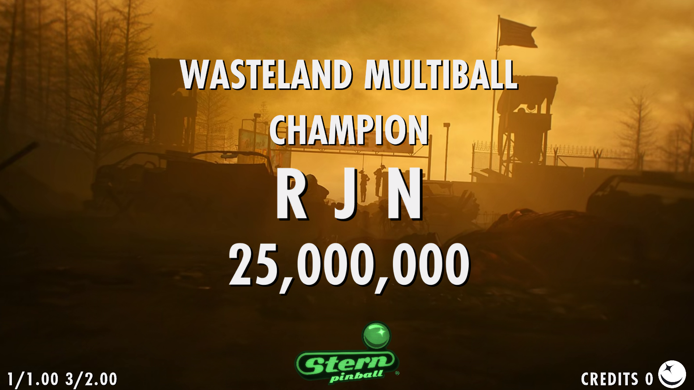

# Spike 3 Extras SSH qualification — 2026-11-17

## Result and scope

**Enabled for recognized Stern Spike 3 encrypted Buildroot cards.** The real
Fallout LE 0.81.0 factory image passed the SSH lifecycle checks below, and the
resulting full-pipeline image reached rendered attract mode in PAD's Spike 3
game emulator. Exact image, rootfs, payload and screenshot hashes are in the
[recorded results](2026-11-17-extras-ssh-spike3-results.json).

This establishes guest userspace/service-hook and game-emulator behavior. It
does not establish a full guest-kernel boot or physical cabinet behavior, or
qualify every historical Spike 3 release. Unsafe or unrecognized boot/rootfs
layouts, LUKS geometry, filesystem objects and competing SSH services are
refused. Other platforms retain the [support matrix](2026-11-17-extras-ssh.md).

## Image integration

The native static AArch64 payload uses Dropbear/dropbearkey 2025.88 and the
same Go SFTP implementation as Spike 2. Password authentication is compiled
out. The Buildroot service hook is `/etc/init.d/S60padsshd -> sshd`, before
`S95game`; it uses `/root/.ssh/authorized_keys`, root-owned mode 0600 inside a
0700 directory. Host identity is generated in persistent `/data/dropbear`.
Disabling removes the startup hook while retaining the managed service,
authorized keys and persistent host keys so the card can be recognized and
enabled again.

PAD unlocks a copied rootfs using the user's existing Spike 3 key source.
It stages/checks the plaintext filesystem, re-encrypts only partition 2's
data segment with the existing volume key, fsyncs, then reopens and hashes the
decrypted read-back. Neither LUKS header is rewritten. The native helper is
installed as `/usr/local/libexec/pad-sftp-server`; the vendor's existing
`/usr/libexec/sftp-server` remains byte-identical.

The tested source was
`fallout_le-0_81_0_spike3.Release.64G.sdcard-secure.raw` (61,924,705,792 bytes).
The rootfs partition begins at LBA 131073, spans 1,228,800 sectors, and has a
16 MiB LUKS data offset with 612,368,384 plaintext bytes.

## SSH lifecycle

Run the same qualification harness as Spike 2, with a **new** working
directory and the user's existing unlock-key configuration:

```sh
python scripts/validate_card_ssh.py \
  --source /path/to/fallout_le-0_81_0_spike3.Release.64G.sdcard-secure.raw \
  --work-dir /path/to/new/spike3-ssh-qualification \
  --engine podman
```

All checks passed using `Spike3WritePipeline` and the built image's own rootfs
under `qemu-aarch64-static` in a dedicated container:

- An SSH-only project builds without an asset replacement.
- Two Ed25519 clients, RSA 2048 and ECDSA nistp256/384/521 authenticate as root
  through the installed startup hook.
- An unknown key and password-only login are rejected; only `publickey` is
  advertised.
- A 4096-byte SFTP upload/download is byte-identical.
- Service restart retains the persistent host keys and pinned host identity.
- A rebuilt key list admits the retained key and revokes the removed key;
  host identity survives another rootfs boot.
- A disabled rebuild has no hook, daemon or working SSH login; host keys
  remain intact.
- **Every byte outside the rootfs data segment matches the source**, including
  LUKS metadata, the signed boot partition, data, connectivity and games.
- Filesystem checks, ownership, permissions and injected content pass before
  write-back. The current production preflight accepts the factory and built
  image; the vendor SFTP helper's hash is unchanged.

Client keys were generated before injection and never substituted to obtain
a passing login. No private client/host keys or user unlock secrets are
committed. The failed first harness run exposed a platform-specific restart
path; the corrected harness was rerun through the entire lifecycle.

## Game emulator

The exact enabled `ssh-card.raw` identified in the results JSON was ingested
by `tools/spike3_emu/s3store.py` and launched with the existing `s3run.sh`
in disposable `pad-ssh-s3-game-20261117`. Its own empty home/state volumes,
read-only checkout/image and read-only user keyfile were used. Existing
emulators, user projects and source card were untouched.

The run used `docker.io/library/pad-spike2-emu:c2977305564` (native AArch64),
QEMU 8.2.2, Xvfb and the existing device/GL/video shims built by `s3build.sh`.
The container needed Python numpy/Pillow/cryptography plus curl/xz utilities.
Its first attempt used a fuse-overlayfs upper layer, which the kernel overlay
driver refused. Binding the private XFS state volume to `/var/tmp/pad-s3`
resolved that test-environment issue; no emulator source changes were made.

After building the shims, the key run commands inside the dedicated container
were:

```sh
python3 tools/spike3_emu/s3store.py build /work/ssh-card.raw
PAD_S3_QEMU=/usr/bin/qemu-aarch64-static PAD_S3_PLAYFIELD=0 DISPLAY=:99 \
  bash tools/spike3_emu/s3run.sh /work/ssh-card.raw \
    --slot 1 --secs 240 --window
# In another shell, dismiss the factory's Guided Setup using the rig helper:
python3 -c 'import sys; sys.path.insert(0,"tools/spike3_emu"); import s3press; s3press.autoguide(1,secs=45)'
```

The game identified **9 of 9 node boards**, rendered Guided Setup, then
reported `run 100 Running - the game is in attract`. Full-screen 1920×1080
HEVC video decoded and rendered. The screenshot shows the attract sequence:

The process was stopped by the requested 240-second cap (exit 137 after the
timeout), after attract was observed.



The game launcher runs the game directly rather than starting all Buildroot
services; the SSH startup-hook test above is therefore separate.

## Regression and review

Combined verification: **438 passed, 9 skipped**. Four reference-crypto cases
require optional reference dependencies, four require Linux namespace support,
and one requires a Spike 1 sample card. Coverage includes both
SSH adapters, project persistence and era selection, the Spike 3 writer/store,
key lookup, build updates, patches, staging, mod exclusion, flash dispatch and
emulator overrides. Native payload hashes/architecture and disable/recognize/
re-enable behavior are checked. Malformed LUKS metadata and logical partition
bounds/overlaps are refused; explicit per-image key sources retain the
original image identity. Independent targeted review passed after the fixes.

The macOS Local Build was rebuilt with PyInstaller. Both embedded native
payloads matched their qualification hashes, its ad-hoc signature passed
strict verification, and a frozen HTTP smoke check confirmed Replace → Extras
and its control state were registered.
